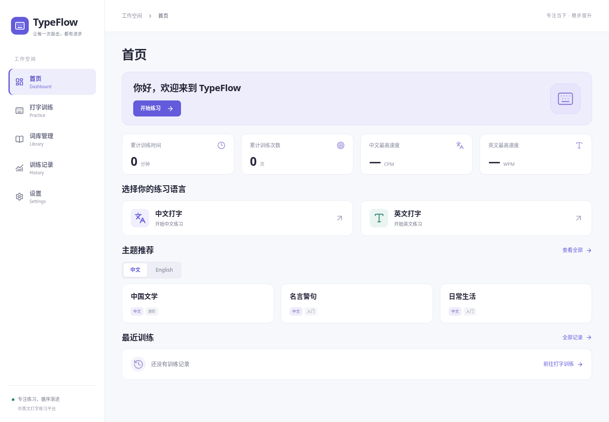
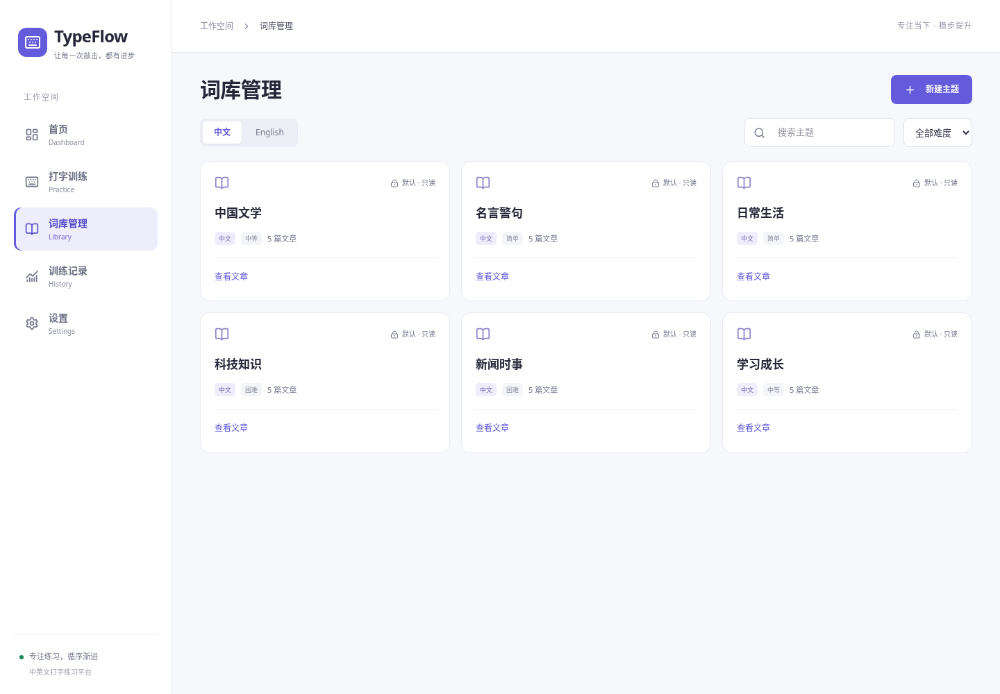
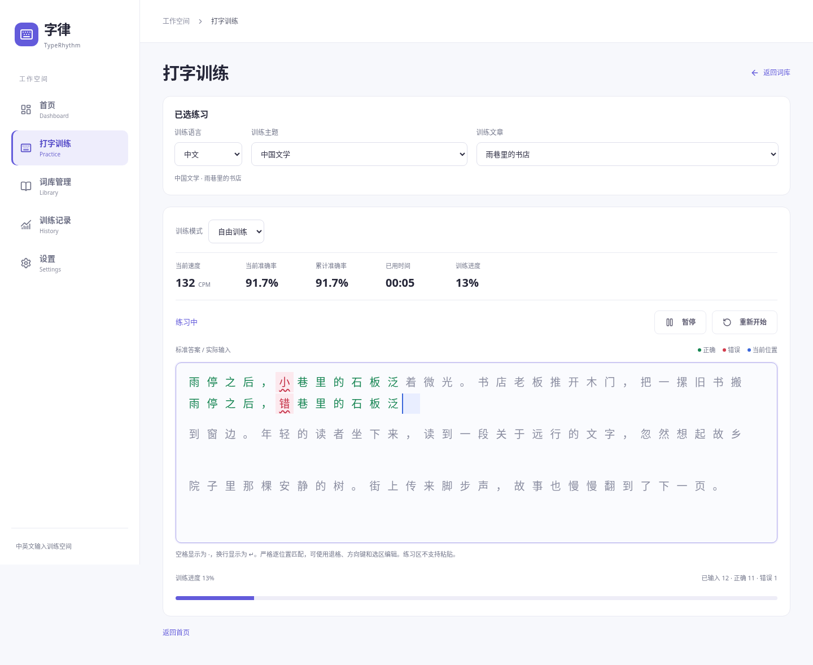

# typeflow

TypeFlow 是中英文打字练习平台。当前完成第七阶段文件导入、设置与持久化加固；保留已验收的训练输入、自然英文排版、成绩公式及历史统计。完整需求和验收计划见 [DEVELOPMENT.md](./DEVELOPMENT.md)。

## 技术栈

Vite、React、TypeScript、TailwindCSS（Vite 插件）、React Router（HashRouter）、Zustand、Recharts、Lucide React、Mammoth、date-fns。安装版本由 package.json 和 package-lock.json 锁定。测试使用 Vitest、React Testing Library、Playwright。

## 开发和验证

在仓库根目录运行以下命令；Codex 云端任务由代理直接执行，无需用户本地执行：

```sh
npm ci
npm run dev
npm run typecheck
npm test
npm run build
npm run preview
```

浏览器测试首次运行前需要安装 Playwright Chromium 及其系统依赖：

```sh
npx playwright install chromium
npm run test:e2e
```

如果缺少系统依赖，使用 Playwright 官方安装流程补齐，不关闭下载验证。测试服务器由 Playwright 自动启动并关闭。

当前云环境已提供 `/usr/bin/chromium`。官方浏览器下载域名被网络策略拦截时，可使用现有浏览器运行：

```sh
PLAYWRIGHT_CHROMIUM_EXECUTABLE_PATH=/usr/bin/chromium npm run test:e2e
```

当前执行沙箱需要获准的执行权限才能访问环境代理、启动本地测试服务器及浏览器。Codex 负责执行，无需用户在本地操作。

## 目录

- src/pages：五个主页面、词库详情与未找到页面。
- src/components：layout、dashboard、typing、library、common。
- src/types/index.ts：语言、主题、文章、训练配置、统计、记录和设置的基础契约。
- src/hooks、src/stores、src/utils、src/data、src/assets：输入、计时、统计、持久化、导入与默认词库模块。
- src/test、tests/e2e：组件测试初始化与浏览器冒烟测试。
- public、imgs：静态资源和后续真实截图预留目录。
- dist：npm run build 生成的生产文件，按学校要求保留；node_modules、测试报告及本地环境变量被忽略。

## 静态部署

Vite base 使用 ./，路由使用 URL hash，适配静态服务器和子目录。生产构建须同时通过 TypeScript 检查。可通过 npm run preview 检查构建结果，最终交付还会验证 serve ./dist。

## 当前限制

当前已包含实时训练与历史统计、TXT/DOCX 导入、设置和数据重置。第六阶段及此前 Windows 实机验收已通过；第七阶段新增文件样本、音效、主题和重置仍待 Windows 人工验收。云端事件模拟不能替代真实设备验证。

## 第一阶段版本与验证

云端使用 Node.js 24.19.0、npm 11.9.0。项目版本由锁文件固定：

| 包 | 版本 |
| --- | --- |
| date-fns | 4.4.0 |
| lucide-react | 1.66.0 |
| mammoth | 1.13.0 |
| react | 19.3.1 |
| react-dom | 19.3.1 |
| react-router-dom | 7.18.5 |
| recharts | 3.10.1 |
| zustand | 5.0.16 |
| @playwright/test | 1.64.1 |
| @tailwindcss/vite | 4.3.3 |
| @testing-library/jest-dom | 7.0.1 |
| @testing-library/react | 16.3.3 |
| @testing-library/user-event | 14.6.8 |
| @types/node | 26.6.6 |
| @types/react | 19.3.0 |
| @types/react-dom | 19.3.0 |
| @vitejs/plugin-react | 6.2.1 |
| jsdom | 30.1.3 |
| tailwindcss | 4.3.3 |
| typescript | 7.0.2 |
| vite | 8.3.5 |
| vitest | 5.0.5 |

已执行：TypeScript 检查、8 项路由/导航组件测试、1 项 Chromium 浏览器冒烟测试、生产构建，均通过。浏览器检查涵盖 hash 导航、刷新、词库详情占位及 Tailwind 样式加载。需求文档 SHA-256 与初始化前一致。完整业务验收仍按 DEVELOPMENT.md 的后续阶段推进。

## 第二阶段：布局与首页

- 主布局拆分为 AppLayout、Sidebar、Header，Zustand 仅管理移动端菜单状态。
- 首页拆分为统计、语言入口、主题推荐和最近训练组件；没有真实成绩时显示 0 或“—”，不使用模拟训练数据。
- 中英文入口携带 language 查询参数导航至训练占位页；本阶段不解析或执行训练业务。
- 主题区保留 12 个规划主题数据，首页默认显示三个中文推荐，可切换三个英文推荐；卡片仅展示名称、难度和语言，点击携带 language 与 theme 参数进入训练占位页。实际文章将在第三阶段添加。
- 移动端菜单支持遮罩、Esc、焦点循环和关闭后恢复焦点；桌面固定显示侧边栏。
- 保留第一阶段全部测试断言；原浏览器测试选择器限定到首页 h1 与精确导航文字，以适应新增内容。
- 第二阶段验证：8 项组件测试、6 项 Chromium 浏览器测试；包括桌面五页切换/刷新、320/390/768px 布局与菜单、横向溢出检查、语言入口及主题数量。TypeScript 检查及生产构建通过。
- 截图为云端 Chromium 实际渲染，真实手机与其他浏览器尚未人工验证。

### 当前首页截图



[查看移动端首页截图](./imgs/dashboard-mobile.png)

### 首页视觉精简

已移除首页标题及欢迎区的宣传副文案，压缩欢迎区、统计卡片和最近训练空态；语言入口仅保留名称和简短说明。主题区支持中文/English 切换、“查看全部”及主题卡片跳转。主题跳转目前导航至现有训练占位页并保留参数，尚不包含训练业务。新截图覆盖上方桌面和移动端截图。8 项组件测试、6 项浏览器测试及 TypeScript/生产构建通过。

## 第三阶段：默认词库与词库管理

### 已完成功能

- 默认中文、英文各 6 个主题，每主题 5 篇独立标题的原创完整短文，共 60 篇。名言主题为明确标注的原创表达，新闻主题为媒体素养练习，不虚构名人出处或新闻事件。
- 默认主题与文章只读。UI 不显示修改入口，Store 也拒绝对默认 ID 的增删改。
- 词库支持中文/English 分类、主题名称搜索（英文大小写不敏感）、难度筛选和空状态。
- 自定义主题支持名称、描述、语言、难度编辑和确认删除。文章支持标题、完整内容、独立难度、字符数、编辑及确认删除。
- 文章字符数使用 Intl.Segmenter 按字符簇统计，包含空格与换行。保存时统一换行并去除起始 BOM，不删除正文空格。
- 首页推荐和文章“开始练习”均可衔接现有训练准备页，显示已选主题及文章。URL 携带语言、主题信息，文章入口还携带 themeId/articleId；引用被删除后显示重新选择提示。未实现输入、计时或成绩逻辑。

### localStorage 约定

Zustand 管理自定义词库和修改动作，存储键为 typeflow.library，格式为 `{ version: 1, data: LibraryTheme[] }`。仅保存自定义数据，默认内容由应用静态模块提供，首次访问自动可用，后续不会重复追加。写入成功后才更新内存；保存失败保留编辑表单，提示失败，不能当作保存成功。

读取时校验版本、字段、日期和 ID 唯一性。损坏或不支持版本的数据不会被覆盖，界面提示并阻止自定义修改；默认库仍能使用，可在备份/修复浏览器数据后重试读取。尚无旧版 schema，因此不猜测迁移未知版本。数据仅保存在当前浏览器，不会同步到其他设备；清理浏览器站点数据会移除自定义内容。

主题名称最多 80 字符，描述最多 1000 字符；文章标题最多 120 字符，正文最多 100000 个 UTF-16 码元。限制同时在表单和 Store 校验，防止过大的输入耗尽本地容量。TXT/DOCX 导入仍留待第七阶段。

### 验证与截图

第三阶段实际执行：TypeScript 检查、19 项单元/组件测试、9 项 Chromium 浏览器测试及 npm run build，均通过。浏览器覆盖默认词库、搜索筛选、主题/文章增删改、删除取消、刷新保留、只读保护、异常数据保护、移动端溢出及首页/导航回归。未在真实手机或其他浏览器人工验证。



[英文词库](./imgs/library-english.png) · [文章详情](./imgs/library-detail.png) · [移动端词库](./imgs/library-mobile.png)

## 第四阶段：核心打字训练

### 输入与同步原理

先以固定中英文文本完成匹配、IME 与状态单元测试，再接入第三阶段真实词库。useTyping 管理临时训练状态；TypingArea 接收原生 textarea 输入；typingCharacters 负责分段、匹配及共享断行；imeInput 独立处理组合事件。

- 标准文本与正式输入统一使用 Intl.Segmenter 的 grapheme 模式分段，原生 selectionStart 的 UTF-16 偏移映射到字符簇索引。
- 每个索引生成唯一 slot，上下两行使用同一 slot 数组及统一格宽和行高（中文 32px；英文采用实际测量字宽）。ResizeObserver 计算列数，两行一起重排，标准 LF 强制断行；错误输入的 LF 只显示 ↵，不能单独改变下排布局。
- 正确位置上下均绿色，错误上下均红色并附下划线，当前输入格蓝色。空格以 · 显示，LF 以 ↵ 显示，Tab 以 ⇥ 显示，比较时仍为原字符。英文大小写、标点、全角半角均严格区分。
- 输入使用完整 value 快照重新匹配；错误会占用自己的格子，不改变两层的物理位置。漏字仍按位置顺移判错，不做编辑距离对齐。退格、Delete、方向键、选区替换由浏览器原生编辑，修改后重新计算。
- 只有一个滚动容器，当前行超出视口才滚动。textarea 定位到可视光标附近，使原生候选窗尽量靠近当前格；真实 Windows 候选窗位置仍需实机确认。

### IME 事件边界

textarea 不绑定受控 value。compositionstart 标记组字；compositionupdate 只更新预编辑提示；组合期间 input/change 不提交。compositionend 读取浏览器的最终 value，随后 input/change 按完整快照去重。没有用 keydown 的按键名拼接文字，也不拦截候选选择用的 Space、Enter 或数字键。

暂停与重开取消预编辑，恢复到最后正式快照；暂停按钮避免指针先移动焦点导致意外提交。继续后恢复输入焦点。组合期间不强制写回 textarea，不移动其选择区。拼音预览不参与匹配、正确数、错误数和进度；组合已提交的多字候选作为一次完整快照匹配。

### 状态与预留数据

状态为 idle → running → paused/running → completed。需要点击“开始训练”，首次非空正式提交才记录 startedAt 和 performance.now() 时间基准。输入覆盖文章长度后自动完成（允许错误），完成后锁定输入；额外字符保留并标错。

useTyping 暴露 submittedCharacters、correctCharacters、incorrectCharacters、progress、session.startedAt、session.accumulatedMs 与 elapsedMs()。elapsedMs() 使用真实单调时间差，扣除暂停时间；没有启动周期计时器或实现第五阶段速度指标。重新开始回到 idle 并清空数据。

训练文章内容以本次会话快照冻结，不随词库编辑改变。语言、主题、文章切换会创建新会话；正在训练时切换或点击站内链接会确认丢弃输入。页面刷新提示由浏览器处理，未完成输入不持久化。浏览器前进/后退仍按 URL 重新加载对应会话。

### 自动化验证结果

本阶段执行 32 项单元/组件测试、13 项 Chromium 浏览器测试（含之前全部 9 项），并执行 TypeScript 检查与 npm run build。固定中英文文本验证完成后才接入真实词库；真实词库入口及首页、词库增删改的回归也已通过。

| 验收范围 | 验证方式与结果 |
| --- | --- |
| 中文正确/错误输入、Backspace、删除后修正 | 固定文本单元测试及浏览器输入，通过 |
| 组合输入、候选提交、连续组合、取消与重复事件 | 独立 IME 单元测试、浏览器合成 composition/input 事件，通过；不是 Windows 实机测试 |
| 英文正确/错误、大小写、空格、标点、Enter | 浏览器键盘编辑与严格匹配测试，通过 |
| 快速连续输入、错误后继续输入、选区/方向键编辑 | 连续快照单元测试及浏览器按键测试，通过 |
| 自动换行、上下格对齐、混合 Unicode、宽度变化 | Chromium 检查每对格的横坐标、宽度及固定 38px 上下行距，通过 |
| 长文自动滚动 | 输入多段长文，检查 scrollTop 大于零且当前格仍在视口内，通过 |
| 暂停不收输入、继续、重开、完成后锁定 | Hook 状态单元测试与浏览器测试，通过 |
| 切换文章清空旧值与进度 | 浏览器测试，通过 |
| 原有页面、路由刷新、词库管理与首页推荐 | 原有测试回归，通过 |

### 必须保留的人工验收项

云端 Chromium 中的输入方法调用和合成 composition 事件不能验证真实系统候选窗。Windows Chrome/Edge + 微软拼音仍需人工测试：候选窗定位；Space/Enter/数字选词；多字候选；连续组词；取消候选；组合中退格；鼠标暂停、继续、重开；缩放及滚动时输入是否稳定。搜狗输入法、真实手机键盘和 Safari 也尚未实机验证，不能宣称已经兼容通过。

### 尚未实现

第五阶段的 CPM/Gross WPM/Net WPM、准确率展示、实时计时展示与限时挑战；第六阶段的完整结果页、成绩自动保存和历史图表；后续文件导入、目标及错误分析均未提前开发。



[英文练习](./imgs/practice-english.png) · [移动端练习](./imgs/practice-mobile.png)

### 第四阶段视觉复核

英文字符格由 32px 收紧至 22px，中文保持 32px。CSS 变量是两行格宽、原生输入框宽度及列数测量的共同来源；索引、字符分段、匹配、IME 与 useTyping 状态逻辑未修改。空格点号使用 0.38 透明度，仅弱化标记本身，错误背景、下划线和当前光标仍保留。

复核暂停/继续的状态守卫、暂停扣时、重开清空、文章身份重建与监听器清理，未发现本轮需要修改的状态逻辑。新增英文/中文格宽与对齐、空格样式、重复暂停继续、取消文章切换保留输入的浏览器断言。最终 32 项单元/组件测试、15 项浏览器测试、TypeScript 检查及生产构建通过；中英文与移动端截图已更新。Windows 实际输入法仍需人工验收，没有开始第五阶段。

### 英文自然字宽排版（当前方案）

英文不再使用 22px 或其他统一格宽。TypingArea 的英文文本使用 Arial/Helvetica Neue 比例字体，正常 letter-spacing，普通空格，不显示点号。useTypingLayout 根据当前实际字体、字号、字重，使用 Canvas measureText 测量标准答案的每个 grapheme；无 Canvas 时使用隐藏 DOM 测量实际字宽，不以固定宽度替代。两排使用同一个 widths 数组；该版本曾根据标准字符和实际字符共同决定宽度；当前已进一步解耦英文两排，详见最后的稳定排版修复记录。

英文断行按可用像素宽度计算，优先在单词边界换行，超长单词按字符簇拆分；标准 LF 强制换行。上下两排共用同一组行，不各自独立排版。跨字符 kerning 与 ligature 关闭以保持独立可寻址字符和 Canvas/DOM 测量一致，未人为增加字母间距。中文仍使用原来的 32px 字符布局及淡空格标记。

ResizeObserver、窗口 resize、document.fonts.ready 与 loadingdone 都会触发重新测量，处理窄屏及字体加载后的重排。字符索引、匹配工具、useTyping 状态和 IME 控制器保持原样。

验证：34 项单元/组件测试、16 项 Chromium 浏览器测试全部通过，TypeScript 检查及 npm run build 通过。新增检查包括 iii/WWW 比例宽度差异、整句宽度与普通文本参照误差小于 1px、普通空格、宽错字仍占窄答案格、字体 FontFace 加载后重新测量、窗口缩放和 CSS zoom=1.25 的双排坐标一致性。CSS 缩放是自动化模拟，不代替不同系统实际浏览器缩放和输入法的人工验收。

[当前英文页面](./imgs/practice-english.png) · [英文移动端](./imgs/practice-english-mobile.png)

## GitHub Pages 在线验收

生产文件发布到 gh-pages 分支根目录，源码仍位于 work 分支。public/.nojekyll 在构建时复制到 dist，避免 GitHub Pages 使用 Jekyll 处理资源。

仓库管理员在 GitHub 的 Settings → Pages 中选择：Source 为 Deploy from a branch，Branch 为 gh-pages，目录为 /(root)，然后保存。启用并完成部署后，默认测试网址为 https://kxsvtrdestiny.github.io/typeflow/ 。不要选择 work 根目录；其中的 index.html 是开发入口。

云端已通过 34 项单元/组件测试、16 项浏览器测试、TypeScript 和生产构建，并使用实际 dist 在 /typeflow/ 子目录验证资源、刷新与英文输入。当前环境访问 GitHub API 和 github.io 受到代理拒绝，不能将分支推送成功视为 Pages 已启用或公网验收通过。请以 GitHub Pages 设置中实际显示的部署状态和网址为准。

在线人工验收建议使用 Windows Chrome/Edge，分别检查中文拼音的空格/数字/Enter 选词、连续组词和候选取消，再检查错误输入后退格、暂停继续、重开、文章切换，以及长文滚动和英文自然字宽。也请新建一个自定义主题和文章，刷新确认本地保存。真实 Windows 输入法和设备交互不能由云端合成事件测试代替。

本测试站仅包含已完成的第一至第四阶段；限时挑战、完整速度统计和成绩历史尚未开发。在线自定义数据保存在该站点所在浏览器；以后下载到本地运行不会自动迁移这些数据。

## 已知问题与修复记录

### 连续英文错误字符裁切（Windows 实测反馈）

**现象与复现证据：** 标准答案为 `iiiiiiii`，输入 `oooooooo` 时，下排 o 看起来像半个字母，连续宽错字也会挤压。修复前在云端 Chromium 重现同一问题，并执行字符完整性回归测试：o 需要约 10.57px，实际共享位置只有 4.21875px，测试明确失败；该次运行的截图已保留，并非事后模拟修复前效果。

**通过代码确认的原因：** naturalWidths 只测量 expected，在标准字符存在时完全忽略 actual。TypingArea 将同一窄宽度用于上下两排，英文字符又继承 `.typing-cell { overflow: hidden }`，因此宽错字被真实裁切。Canvas 与 CSS 字体相同，原始测量未向下取整；在该复现中，主因是测量对象选择错误和隐藏溢出，而非两排索引不一致或 Flex 随机压缩。旧测试甚至要求错误 W 仍沿用窄 i 的宽度，这是原测试覆盖不足，现已修正。

**修复方案：** 每个索引采用 `w(i) = max(measure(expected[i]), measure(actual[i]))`。measure 使用当前字体、字号、字重，除 advance width 外也计入 actualBoundingBoxLeft/Right 的字形墨迹范围；对左侧越界墨迹给出对应偏移。宽度按 1/64 CSS px 向上量化，避免布局舍入丢失字形边缘，不统一放大所有字符，也不恢复固定 22px 格宽。英文字符容器改为 overflow: visible、min-width: 0、禁止 flex-shrink；完整性由正确测量保证，而不是靠让字符溢出相互遮挡。

**同步机制：** 一个索引只生成一份共享宽度，两排同时使用；错误字符扩宽后，统一布局函数同时重排两行。Backspace 后从实际完整值重新匹配和测量，正确字符数、错误字符数、光标与进度仍沿用原有逻辑。删除宽错字后格宽恢复，长文仍使用单个滚动容器。ResizeObserver 与字体加载后的重测保留。中文固定字符布局、IME、useTyping 和字符索引工具没有修改。

**测试方法与结果：**

| 用例 | 检查内容 | 结果 |
| --- | --- | --- |
| iiiiiiii → oooooooo | 每个 o 的所需字宽不超过共享格宽，无裁切 | 修复前失败，修复后通过 |
| iiiiiiii → WWWWWWWW | 连续 W 完整，无重叠，两排同列 | 通过 |
| Hello World → MMMM WWWWW | 混合宽度、空格和错字完整性 | 通过 |
| Progress often arrives quietly. → 连续 28 个 x | 连续错字无挤压；未输入透明占位不作为可见字形测试 | 通过 |
| 错误输入 → 逐个退格 → 正确输入 | 格宽恢复、错误颜色清除、光标和断行同步 | 通过 |
| 标点、连续空格、大小写及 i/W 交替 | 正常匹配及字形边界、两排横坐标/宽度 | 通过 |
| 长文宽错字、缩放和窗口变化 | 自动滚动、光标可见、共享断行和坐标 | 通过 |

自动化同时回归原有中文模拟 IME、英文输入、暂停继续、重新开始、文章切换、词库和首页。Windows 系统字体、真实输入法及实际缩放仍待用户本地复测，不将云端通过宣称为 Windows 实机通过。

[修复前截图](./imgs/input-width-before.png) · [修复后截图](./imgs/input-width-after.png)

补充：长文宽错字测试还定位到共享滚动计算未包含 typing-lines 相对容器的内边距，会令底部光标部分超出视口。已只在布局层补齐偏移与底部安全边距，输入和 IME 状态逻辑不变。

本次最终验证：35 项单元/组件测试、23 项 Chromium 浏览器测试、TypeScript 检查、npm run build 均通过；dist 已由修复后的源码重新生成。此前修复前失败运行与修复后通过运行分开记录。等待 Windows 本地人工复测，没有进入第五阶段。

## 英文标准答案稳定排版修复（当前方案）

### 上一次修复的局限与本次复现

之前 `max(标准字符宽度, 实际字符宽度)` 解决了宽错字裁切，却把实际输入反馈到答案的 widths 数组。实际输入较宽时，答案中原本窄的字母或空格也被撑宽；同一数组又被用于分行，因此答案断行也可能改变。这是机制本身的耦合，而不是单纯的字体间距问题。

本次先在旧实现上加入坐标回归：答案 `Maya found a blue notebook on a park bench.`，输入 16 个 y。修复前测试明确失败，例如索引 4 的格宽从 5.28125px 变为 10px，后续索引 5 的横向偏移从 53px 变为 58px。失败运行截图保留在 imgs/unstable-answer-before-input.png 和 imgs/unstable-answer-after-y.png。

### 布局解耦

1. 标准答案自然字宽数组只测 expected，与 actual 无关；标准答案行只由标准文本、字体及容器可用宽度计算。字体加载或窗口变化允许重排，输入错误不允许影响答案排版。
2. 实际输入单独测 actual 的自然字宽（包含字形墨迹边缘与亚像素向上量化），保留正常空格。错误字符不受标准字符窄宽度限制，也不借助 overflow:hidden 裁切单个字母。
3. 标准答案每行确定一段全局 grapheme 索引，下排沿用该段索引显示实际输入；状态判断、Backspace、选区编辑、进度及 IME 仍由原有统一索引处理。英文现在保证逻辑索引与行序对应，不再要求不同宽错字与答案横坐标一致。
4. 为使后续答案行的纵坐标也稳定，英文输入行预留固定的显示及滚动条高度。某一标准行对应的实际输入超宽时，仅该输入行可以自然横向滚动；光标行自动滚动到当前实际字符。标准行不随下排横向滚动，后续答案行不被撑高。
5. 中文继续使用原有 32px 双排布局及逐像素对齐。useTyping、imeInput、typingCharacters 与 DEVELOPMENT.md 未修改。没有恢复英文 22px/32px 字符格，也没有进入第五阶段。

### 验证方式与结果

- 在 390/768/1280px 三种窗口宽度下，分别输入 16 个 y、W、i、o，并逐个 Backspace 删除，再输入正确前缀。浏览器采集每个答案字符的实际字宽、相对视口横纵坐标和所属行起始索引，要求与输入前完全相等，均通过。
- 连续宽错字仍检查实际字形所需宽度及相邻格不重叠；窄答案输入 o/W、混合 M/W、连续 x、标点和连续空格均通过。此前“错字必须与标准字同宽同横坐标”的断言与新原则冲突，已替换为逻辑行归属、字形完整性和答案坐标稳定性断言。
- 长文测试按标准答案的行容量构造足量实际输入，验证纵向同步滚动、光标可见、下排自然横向滚动、窗口变化及 CSS 缩放。中文模拟组合输入、候选提交、暂停/继续、重开、文章切换和全部首页/词库回归保留。
- 最终执行 36 项单元/组件测试、26 项浏览器测试、TypeScript 检查及 npm run build，均通过。Windows 系统字体和真实输入法仍待用户实机复测。

当前稳定答案的截图对比：[输入前](./imgs/stable-answer-before-input.png) · [连续输入 y 后](./imgs/stable-answer-after-y.png)。颜色按索引变化，字母间距和断行不变。

## 第五阶段：实时统计、计时与本次训练结果

### 当前公式（以本轮用户确认口径为准）

所有中英文字符计数均使用 Unicode grapheme。普通空格、标点、换行与汉字/英文字母一样：位置严格匹配时计一个正确字符，错误时计一个错误字符；组合 emoji 和组合重音按一个可见字符簇计。CRLF/CR 统一为 LF，不自动去除正文空格，不忽略大小写或标点。

- 中文 CPM = **当前正确 grapheme 数 / 有效分钟数**。本轮明确要求“正确字符数”，因此替代早期计划中“仅正确汉字数”的口径，标点、空格、换行同样计入正确速度。
- 英文 WPM = **当前正确 grapheme 数 / 5 / 有效分钟数**，采用每五个字符一个标准词；不把错误字符计入速度。本阶段显示这一正确速度，不新增 Gross WPM 指标。
- 当前准确率 = 当前正确字符数 / 当前保留输入字符数 × 100%。Backspace、Delete 和选区替换后根据完整输入重新匹配。
- 累计准确率 = 累计正确输入事件字符数 / 累计输入事件字符数 × 100%。只统计正式插入/替换的 grapheme，删除不新增事件字符，也不扣除过去事件。修正后的新输入会加入累计统计；被删除字符不会把累计准确率重置。
- 进度 = min(当前保留输入字符数, 标准字符总数) / 标准字符总数。进度表示位置覆盖，不代替准确率。
- 没有输入时准确率为 0%；没有有效耗时或耗时为零时速度为 0。计算统一处理非有限数与零分母，不显示 NaN/Infinity/负时间。速度按整数展示，准确率保留一位小数。

例如标准为 ABCDEF，输入 AX，再退格删除 X 并输入 B：当前输入 AB，当前准确率 100%；累计输入 A/X/B 共 3 个，其中 2 个正确，所以累计准确率 66.7%。重新开始才清空两种统计。

### 输入事件与 IME 边界

保留第四阶段的原生非受控 textarea、统一 grapheme 索引与稳定答案排版。只给正式提交额外携带 beforeinput 的原生选择区/插入数据及事件编号，供累计统计使用。compositionstart 保存选择区，compositionupdate 不提交；compositionend 的多字候选只计一次，随后 input/change 根据值与事件编号去重。

同一文字被选中后重新输入相同文字，也算一次真实输入事件；React input/change 重复通知不算两次。没有可靠选择区元数据时，按完整输入的公共 grapheme 前后缀定位新插入片段；纯删除和被移动的旧字符不获得新的正确输入事件。组合重音改变前一个 grapheme 时，回退到字符簇差异计算，避免把重音拆成独立字符计分。撤销/重做若重新引入字符，按本次恢复的新增片段统计，不重置累计历史。

练习区仍阻止粘贴和拖入；词库表单不受此限制。暂停、完成或限时截止后拒绝新的正式提交，未提交拼音不计入字符数和累计准确率。

### 有效时间与暂停规则

点击开始只解锁输入，**第一次非空正式输入**才记录 startedAt 与 performance.now()。首次候选字提交之前的拼音选择等待不启动计时；计时已开始后的正常组词时间属于有效训练时间。

有效耗时 = 已结束活动段耗时 + 当前活动段的真实时间差，暂停时间扣除。useTimer 的 200ms interval 仅刷新显示和检查截止时间，不累计“经过了多少次 interval”。数字使用 tabular-nums 保持宽度稳定。

窗口 blur 或 document.hidden 自动暂停，不自动恢复；回来后手动点击继续。页面隐藏事件先检查限时是否已经到期，再决定暂停。重新开始、模式变更和文章切换清空本次时间、计数和结果；重新练习保留当前模式/时长。刷新与离开仍按之前未完成会话策略确认，不持久化未完成输入。

### 自由与限时模式

自由训练输入达到标准全文长度即完成，允许存在错误。限时可选 1/3/5/10 分钟，暂停时剩余时间停止，若全文提前输入完则提前完成。进行中的模式或时长变更需确认放弃当前会话；取消不清空数据。

每次正式输入前以及刷新 tick 都检查有效耗时是否达到限额。截止后的输入或候选提交不进入成绩，结算用时封顶为设定时长，即使浏览器晚执行回调也不增加额外有效时间。完成后时间、计数、结果都冻结，重复事件不能重复结束或继续计分。

### 结果与第六阶段接口

本次结果包含文章、主题、语言、模式、结束原因、有效时间、正确速度、两种准确率、正确/错误字符数与进度，支持再练一次、返回词库和首页。TrainingOutcome 是可供第六阶段消费的完成数据结构，包含事件累计与时间字段；**当前不写入训练历史或首页累计数据，不实现历史分析页面**。

### 第五阶段验证

本阶段新增公式、事件差异与选择替换、四种时长边界、暂停扣时、到期前拒绝输入、极短时间和非有限数单元测试。浏览器测试使用暂停的可控测试时钟验证精确公式，避免真实自动化操作耗时影响断言；验证到期、早完成、删除后的两种准确率、同值替换、候选重复事件、未提交拼音、隐藏/恢复、模式确认、重开、文章切换及粘贴限制。

最终执行 57 项单元/组件测试、32 项浏览器测试、TypeScript 检查和 npm run build，均通过。第四阶段英文坐标稳定性、宽错字完整性及中文输入回归保持通过，排版测量与分行工具未修改。

用户已确认第四阶段 Windows 中文输入法与英文实机验收通过；第五阶段新增的失焦暂停、限时边界及累计统计仍需 Windows 人工复测。隐藏/恢复自动化通过模拟 visibilitychange 和 blur 事件测试，不等于所有操作系统后台行为均已实测。

截图来自应用实际运行的自动化演示会话，使用可控时钟和输入得到，不是用户历史成绩，也未写入历史数据：

[训练实时统计](./imgs/stage5-live-statistics.png) · [训练结果](./imgs/stage5-training-result.png) · [移动端结果](./imgs/stage5-result-mobile.png)

## 第六阶段：本地训练历史与数据统计

### 记录结构与保存时机

Zustand 的 useHistoryStore 管理记录，localStorage 键为 `typeflow.history`，格式为 `{ version: 1, data: TrainingRecord[] }`。一条记录包含独立 ID、startedAt/completedAt、语言、主题和文章 ID、主题名与文章标题快照、模式、限时时长、结束原因及第五阶段结算的 LiveMetrics 快照：有效毫秒、CPM/WPM、当前与累计准确率、正确/错误/保留字符数、累计输入事件计数和进度。timedMinutes 仅在限时模式下使用，自由模式忽略该保留字段。

保存层显式列出允许写入的字段，不保存标准文章正文、textarea value 或实际输入全文。主题/文章名称是完成时复制的字符串；删除词库内容不影响已有历史的展示。

只有 completed 结果才触发保存，文章完成和限时到期均适用。有效记录要求时间、日期及指标结构合法，有效耗时大于零、当前保留字符和累计提交字符均大于零。全错但有真实输入/时间的记录有效，速度为零；零耗时或无输入会明确提示不保存。暂停、未完成刷新、离开和重新开始没有完成结果，不生成记录。

### 去重与保存失败

每轮会话分配 UUID，重开/切模式会获得新的轮次 ID；同轮完成结果使用该 ID 保存。useSaveHistory 监听稳定的完成快照，Store 在写入前检查磁盘已有 ID，因此重复 effect、StrictMode 和重复完成通知不会追加多条。删除记录后，未变化的已完成页面不会因 Store 重新渲染自动把记录补回。

写入成功才更新内存与显示“已保存”；配额不足或禁止写入时，保留本次结果并提示未保存、离开将丢失，可用同一 ID 重试。未自动保存的结果不会被伪装成历史成绩。失败状态也可在历史/首页查看。未实现跨刷新保存失败队列，因此请在离开结果页之前重试。

读取校验 schema 版本、必填快照、有效日期、语言/模式/时长枚举、唯一 ID、有限且非负指标、计数一致性、准确率和进度范围。无法读取、损坏 JSON、重复 ID 或未知版本时保留原始数据，阻止自动覆盖，提示重试；用户备份修复后可重读，或通过二次确认明确清空。当前是首个历史版本，不猜测未知版本的迁移方式。

### 统计口径与页面联动

首页和历史页共用 historySummary：

- 累计次数为有效记录数；累计时长为记录中有效 elapsedMs 的和，不含暂停。
- 平均准确率采用**各次当前准确率的算术平均值**，不按输入长度加权。例如 80% 与 100% 两次训练，平均为 90%。累计准确率保留在每条详情中，不混用为首页平均值。
- 最佳中文取中文记录的 CPM 最大值，最佳英文取英文记录的 WPM 最大值，不能混合比较。
- 所有速度与准确率读取第五阶段结果快照，不以历史页的新公式重新结算。
- 首页最近训练按完成时间降序取 3 条。删除或清空 Store 成功后，两页统计同时更新；刷新从相同存储键恢复。

历史列表支持语言、自由/限时模式及日期顺序筛选。顶部概览始终统计全部记录，并有明确标注；详情弹窗展示其余字段。列表和趋势都按解析后的 completedAt 排序，不依赖磁盘数组顺序，同时间用 ID 稳定排序。

Recharts 趋势默认显示最近 7 次，按时间升序绘制；中文 CPM 与英文 WPM 使用独立语言切换，不同单位从不进入同一条曲线。趋势按当前模式筛选，语言由图表自身切换控制，切换列表语言也同步图表语言。没有记录显示空态，一条记录显示点，悬停显示具体日期和成绩。关闭图表动画；图表代码懒加载，不影响首页初始代码加载。

### 删除与限制

单条删除和全部清空都需二次确认。仅删除 `typeflow.history` 中相应记录，词库和设置不受影响；清空也可明确重置无法读取的历史。删除不可撤销，不维护另一个会与记录漂移的统计缓存。

数据只在当前浏览器站点本地保存，不上传服务器、不跨设备同步；清理站点数据会移除历史，在线站点与 localhost 的数据也不会自动迁移。监听 storage 事件同步普通跨标签变更，写前读取最新磁盘记录减少旧标签覆盖；localStorage 不提供跨标签事务，多个标签同时写入仍可能竞争，不将其描述为数据库级并发保证。

### 验证与截图

实际执行 70 项单元/组件测试、37 项浏览器回归、TypeScript 检查及 npm run build，均通过。新增覆盖正常完成/限时保存、ID 去重、未完成刷新/暂停/重开/退出不保存、磁盘重载、筛选排序、七次趋势与单位分离、名称快照、删除/清空首页联动、读写异常与重试，保留第四、第五阶段全部既有测试。另使用实际 dist 验证 /typeflow/ 子目录的历史刷新与懒加载图表资源。

截图数据来自在独立自动化浏览器中真正完成的 14 轮演示训练，计时受控，每条记录都经过第五阶段结果及新保存链路；不是应用内置或真实用户历史，应用首次打开仍为空。

[历史记录页](./imgs/stage6-history.png) · [英文速度趋势](./imgs/stage6-english-trend.png) · [移动端历史](./imgs/stage6-history-mobile.png) · [首页真实数据联动演示](./imgs/stage6-dashboard.png)

第四、第五阶段 Windows 实机验收已由用户确认；第六阶段存储、图表与跨页联动仍待本轮用户验收。未进入第七阶段。

响应式修复记录：截图实测确认 Recharts 隐藏 tooltip 在缩小窗口后仍保留旧桌面横坐标，造成文档横向溢出；已限制趋势图区域绘制边界，并增加先悬停提示框再切换移动端的浏览器回归。未改变训练区域的字符容器或排版。

## 第七阶段：文件导入、设置与持久化加固

### 本地文件导入

词库页和主题详情提供导入入口：选择 TXT/DOCX → 本地解析 → 现有文章编辑表单 → 修改标题、保存到的自定义主题、正文及难度 → 确认保存。取消或解析失败不创建文章，内置词库仍只读；没有自定义主题时先创建主题。

TXT 默认以严格 UTF-8 解码，移除 UTF-8 BOM，统一 CRLF/CR 为 LF。编码错误明确提示，可手动按 GB18030 重读；依赖浏览器 TextDecoder 对该编码的支持，不支持时提示错误，不静默猜测。合法但语义乱码的文本仍需通过预览人工判断。

DOCX 使用已安装的 Mammoth extractRawText，在本地 Web Worker 提取纯文本；不上传、不插入或渲染文档 HTML。文件内的 HTML 形态字符只是可编辑文本。损坏文件或解析失败会提示；关闭弹窗终止解析。只支持 TXT 和 DOCX，不支持 DOC、图片 OCR 或富文本格式保留。

文件上限 2 MiB，正文沿用 100000 个 UTF-16 代码单元限制。DOCX ZIP 预检限制 512 个条目、声明解压总量 8 MiB，拒绝加密、多磁盘、ZIP64 和缺失正文结构，Worker 解析超时 10 秒终止。这些是资源防护，不代表对任意恶意文档的完整安全审计。

### 设置与成绩保存

设置存储键为 typeflow.settings，格式 `{ version: 1, data: UserSettings }`。包含浅色/深色、默认语言、自由/限时模式、1/3/5/10 分钟、正确/错误音效开关及成绩自动保存。默认浅色、中文、自由训练、两种音效关闭、自动保存开启。保留的 dailyGoalMinutes 字段不在本阶段提供功能。

写入成功后才更新设置；读取异常、损坏或未知版本保留原始数据、使用默认值并阻止静默覆盖，提供错误与重读入口。设置刷新后恢复，普通跨标签变更通过 storage 事件同步；不提供跨标签事务保证。

入口明确指定的文章/主题语言以及 mode/minutes 优先于默认设置。默认选项用于新训练页面，每轮开始时冻结音效与自动保存选项，修改设置不改变当前轮的行为；重开使用新设置。切换外观可以立即生效，但仅改变颜色，不改变字体、测量、字符索引、分行或 IME 逻辑。

自动保存关闭时仍结算并显示结果，明确显示未写入历史。每轮完成时锁定保存决定，同一完成结果不会因为随后开启设置而补存；重新训练属于新一轮。开启时沿用第六阶段有效记录校验和轮次 ID 去重机制，失败仍明确提示并允许重试。

### 音效与深色模式

Web Audio 在开始/继续的用户操作中解锁；使用本地生成的简短正弦波（约 100ms，增益 0.08），不下载音频。正确和错误开关独立，每次正式字符提交至多播放一次；混合正确/错误的提交优先播放已启用的错误音。基于累计正式输入事件的差值触发，IME 组合预览、删除、暂停与完成后的事件不播放；完成状态不补播末次声音。音频接口不可用、权限或播放失败均不影响输入与计时。

深色模式仅覆盖背景、文字、边框、正确/错误/待输入及光标颜色，保留蓝紫色风格。浏览器测试比较切换前后的英文字符坐标和字体，确保颜色变化不影响自然排版。

### 本地数据重置

必须二次确认。逐项删除且只删除 typeflow.library、typeflow.history、typeflow.settings，然后重载对应 Store；不会调用 localStorage.clear()。默认词库来自内置数据，因此重置后保留 12 个主题、60 篇文章。其他应用的键不受影响。

自定义主题和文章、历史以及设置会被移除，不可撤销。逐项记录成功与失败，部分删除失败时明确显示失败项目，不声称全部成功，可重试。数据仍仅保存在当前浏览器站点，不跨设备同步，也没有新增备份或导出功能。

### 验证与截图

执行 80 项单元/组件测试、45 项浏览器测试、TypeScript 检查与生产构建，全部通过。覆盖 TXT BOM/换行/编码重读、真实 DOCX Worker 纯文本解析、损坏/大文件、取消不写入、编辑主题标题正文、导入后训练、设置重载和写入失败、自动保存冻结及不补存、IME/删除/暂停音效抑制、深色字符坐标稳定和重置部分失败/外部键保护；保留全部既有训练、统计和历史回归。

另使用实际 dist 在 /typeflow/ 子目录验证 DOCX Worker 资源加载、导入文章训练、历史持久化与懒加载趋势图，全部通过。

浏览器音效测试使用模拟 AudioContext 验证触发时机与频率，不等于 Windows 声卡可听效果验证。截图来自实际运行的独立演示会话，不是默认数据。第七阶段等待 Windows 人工验收，未进入第八阶段。

[导入编辑预览](./imgs/stage7-import-preview.png) · [浅色设置](./imgs/stage7-settings-light.png) · [深色设置](./imgs/stage7-settings-dark.png) · [深色训练](./imgs/stage7-dark-practice.png) · [移动端设置](./imgs/stage7-settings-mobile.png)

### 第七阶段音效修复记录

Windows 人工测试报告打开错误音效后听不到声音。代码确认正确/错误开关独立，错误提交通过累计事件差值选择错误提示音，IME 去重未屏蔽正常提交。已用回归测试复现播放器缺陷：开始按钮调用异步 AudioContext.resume() 后，首个错误输入可能先到达；旧 play() 发现状态非 running 便直接返回，即使随后恢复也永久丢失该音。旧实现同时静默捕获初始化/播放失败，缺少定位反馈。该竞态是已证实的代码问题，不能据此断定 Windows 用户当时的具体声卡或浏览器状态。

修复后在开始/继续的用户交互中初始化并解锁 AudioContext，播放等待同一个恢复任务；恢复失败或两秒超时明确提示并提供“重试音效”，不阻断训练。待播放请求在恢复后重新检查轮次及 running 状态，避免暂停、结束、重开或卸载后补播。错误音从 220Hz 调整为 440Hz，正确音保持 660Hz；包络延长至 100ms、峰值增益调整至 0.08，提高低音量设备上的可听度，不使用外部资源。系统音量或站点静音无法由 Web Audio API 可靠检测，需要用户检查。

增加异步恢复丢音（修复前失败、修复后通过）、恢复失败及重试、暂停/销毁后不补播测试；浏览器覆盖全部四种独立开关组合、正确/错误 IME 候选提交、删除/暂停/完成抑制。另通过真实 Chromium AudioContext 和 AnalyserNode 检测错误音的 440Hz 振荡器及非零采样信号，而非仅模拟播放函数；这仍不代表 Windows 实体扬声器听音验收。未修改核心输入、IME、自然排版或计时逻辑。

本次音效修复完整验证：83 项单元/组件测试、51 项浏览器测试、TypeScript 检查及 npm run build 全部通过，dist 已更新。等待 Windows 实际听音复测。
